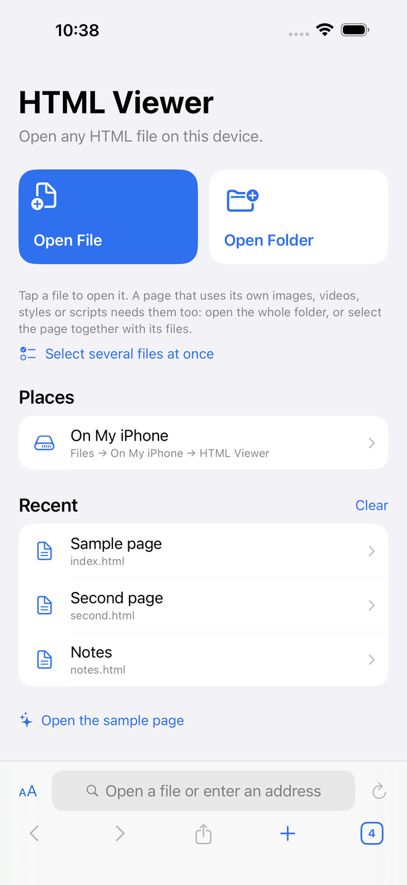
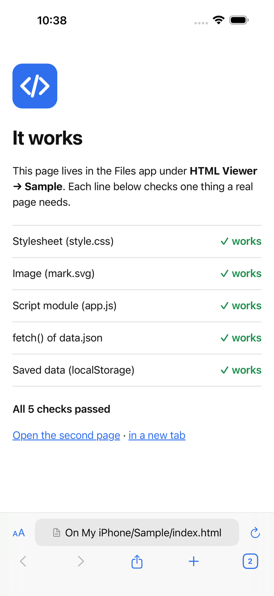
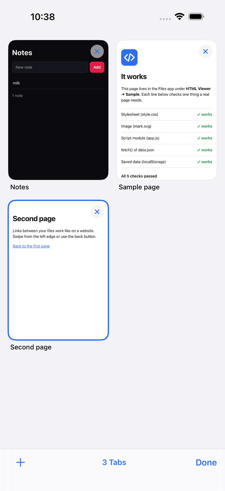
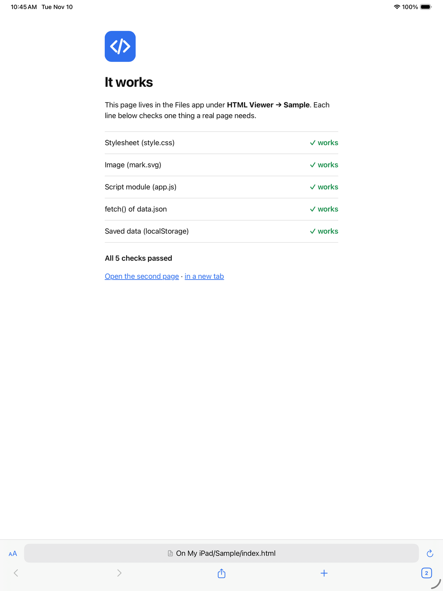

# HTML Viewer for iPhone and iPad

Open HTML files that are stored on your iPhone or iPad, in tabs, the way Safari opens websites.

iOS has no built-in way to do this properly: the Files app only shows a static preview of an HTML file, with no
scripts, no links and no saved data. HTML Viewer opens the file as a real, working page. It is made for
single-file web apps, saved websites, exported reports and notes, offline documentation, and pages you are
building yourself.

<p>
  
  
  
  
</p>

## What it does

- **Opens any HTML file** from the Files app: on the device, iCloud Drive, or any other location Files shows.
- **Tabs like Safari.** Open as many pages as you like, switch between them in a thumbnail overview, and open
  links in new tabs.
- **Remembers everything.** Open tabs, each tab's back/forward history, recent files and folders all come back
  the next time you open the app.
- **Pages work like on a real website.** Scripts, styles, images, video and audio (with seeking), fonts, links
  between your files, `fetch()`, JavaScript modules and saved data (`localStorage`) all work.
- **Whole folders.** Open a folder that holds a complete site and browse it; nothing is copied.
- **Also a normal browser.** Type a web address or a search in the address bar; links to websites just open.
- Find on page, zoom, desktop/mobile site, view source, share, downloads, and "Open in HTML Viewer" from the
  Files share sheet.

No account, no ads, no tracking. The app makes no network connections of its own; only the pages you open do.

## Requirements

- iPhone or iPad with **iOS / iPadOS 15 or later**.
- A way to install an `.ipa` file (see below). The app is not on the App Store, and the download is
  **unsigned**: Apple only lets a device run apps that are signed for it, so the file has to be signed with
  your own Apple ID or by a signing service as part of installing it.

## Download

**[Download HTML-Viewer.ipa](https://github.com/varnealt2-cloud/html-viewer-ios/releases/latest/download/HTML-Viewer.ipa)**
(latest release, about 300 KB).

## Install

Pick the option that matches what you have. All of them install the same file.

### Without a computer

You need a **signing service**: a paid service that registers your device with an Apple developer account and
signs apps for it from the phone itself.

**[Signulous](https://www.signulous.com)** (this is what the app was first installed with):

1. On the iPhone or iPad, open signulous.com in Safari, buy a plan and register the device. Follow their
   instructions until your device shows as registered; activation can take a while after purchase.
2. Download **HTML-Viewer.ipa** from the link above. Safari saves it to the Files app, in Downloads.
3. In Signulous, upload the `.ipa` (in the Signulous app or on your dashboard on their website), then choose
   **Sign**.
4. Choose **Install** and confirm. The HTML Viewer icon appears on the Home Screen.
5. If iOS says the developer is not trusted: **Settings → General → VPN & Device Management**, tap the
   developer entry and choose **Trust**.

Other signing services work the same way: register the device, upload the `.ipa`, sign, install. Prices and
reliability vary and change, so check the service's own site before paying.

### With a Windows PC or a Mac (free)

These tools sign the app with your own Apple ID. With a free Apple ID the app **stops opening after 7 days**
and has to be refreshed (signed again); your tabs and files are kept. A paid Apple Developer account makes it
last a year.

**[Sideloadly](https://sideloadly.io)** (simplest):

1. Install Sideloadly on the computer. On Windows, also install iTunes and iCloud **from Apple's website**
   (not the Microsoft Store versions), as Sideloadly's site explains.
2. Download **HTML-Viewer.ipa** to the computer.
3. Connect the iPhone or iPad with a cable, unlock it and tap **Trust This Computer**.
4. Open Sideloadly, drag the `.ipa` into it, type your Apple ID, and press **Start**. Enter your Apple ID
   password and the verification code when asked.
5. On the device: **Settings → General → VPN & Device Management**, tap your Apple ID and choose **Trust**.
6. On iOS 16 or later, turn on **Settings → Privacy & Security → Developer Mode** and restart when asked.
7. Every 7 days, connect and press Start again (or switch on Sideloadly's automatic refresh).

**[AltStore](https://altstore.io)** (refreshes itself over Wi-Fi):

1. Install **AltServer** on the computer from altstore.io and use it to install AltStore onto the device,
   following their guide.
2. Download **HTML-Viewer.ipa** on the device.
3. Open AltStore → **My Apps** → **+** and choose the `.ipa`.
4. AltStore refreshes the app when the device and the computer running AltServer are on the same Wi-Fi.

**[SideStore](https://sidestore.io)** needs a computer only once, for setup, and then refreshes apps on the
device itself. Follow their guide to install it, then add the `.ipa` the same way as in AltStore.

### With a Mac and Xcode (build it yourself)

```sh
brew install xcodegen
git clone https://github.com/varnealt2-cloud/html-viewer-ios
cd html-viewer-ios
xcodegen generate
open HTMLViewer.xcodeproj
```

In Xcode, select the HTMLViewer target → **Signing & Capabilities**, choose your team, change the bundle
identifier to something of your own, pick your device and press Run.

## How to use it

**Open a page**

- **Open File** and tap a file. It opens straight away.
- **Open Folder** and choose a folder. If it has an `index.html`, that opens; otherwise you get a list of the
  folder's files to tap through. This is the right choice for a saved website.
- **Select several files at once** when a page comes with a few separate files and they are not in a folder
  of their own: tick the page and its files, then tap Open.
- From the Files app: long-press a file → **Share** → **HTML Viewer**.
- Or copy files and folders into **Files → On My iPhone (or On My iPad) → HTML Viewer**. They show up in the
  app under **Places**.

**One thing to know.** iOS only lets an app read what you actually pick. A page that is one self-contained
`.html` file just works. A page that loads its own images, videos, stylesheets or scripts from files next to it
needs those files too, so open the **folder**, or select them together with the page. Otherwise those parts
show as missing.

**Tabs**

- The square with a number, bottom right, shows all tabs. Tap one to switch, **×** to close it.
- **+** opens a file, a folder or a new empty tab.
- A link that opens a new window opens a new tab.

**The rest**

- **AA** button: find on page, zoom, desktop site, view source, close tab.
- Tap the address bar to type a web address or search.
- Swipe from the screen edge, or use the arrows, to go back and forward.
- The reload button loads the file again, so edits you made to it show up.
- A new tab's **Open the sample page** runs a five-line self-check of the app.

## Questions

**Images, styles or videos are missing from my page.**
The page keeps them in separate files that the app was not given. Use Open Folder on the folder that contains
everything.

**My web app's saved data is not there.**
Pages keep their data inside the browser that opened them. Data saved while the page was open in Safari or
another app stays there; in HTML Viewer the page starts fresh and then keeps its data from then on. If the page
has its own export/import, use that to move it.

**The app stopped opening after a week.**
It was signed with a free Apple ID, which lasts 7 days. Refresh it with the tool you installed it with. Nothing
in the app is lost.

**"Untrusted Developer" or "Developer Mode required".**
See steps 5 and 6 under Sideloadly above.

**Does anything leave my device?**
No. Your files are read on the device. Internally the app serves them to its own web view from a private
address on the device (`127.0.0.1`), protected by a random key, so that pages behave as they do on a real
website. Nothing is uploaded.

## How it was tested

Every change is built and tested automatically on GitHub's Mac runners (see the
[Actions tab](https://github.com/varnealt2-cloud/html-viewer-ios/actions)):

TESTED_PLACEHOLDER

The first version was also installed with Signulous and used on an iPhone 17 Pro Max.

## For developers

- SwiftUI app around `WKWebView`; no third-party dependencies.
- `App/Server/LocalServer.swift`: a loopback-only HTTP server (Network framework) with byte-range support.
  Local pages are served from `http://127.0.0.1:<port>/<random token>/…` instead of `file://`, which is what
  makes `fetch`, modules and media seeking work.
- `App/Model/BrowserStore.swift`: tabs, opened folders (security-scoped bookmarks), recents, persistence.
- `App/Web/Tab.swift`: one tab; web views are created lazily and released for background tabs, keeping
  history.
- `Tests/` unit tests, `UITests/` end-to-end tests. The project file is generated with
  [XcodeGen](https://github.com/yonaskolb/XcodeGen) from `project.yml`.
- Pushing a tag like `v1.2.0` builds, tests and publishes a release.
